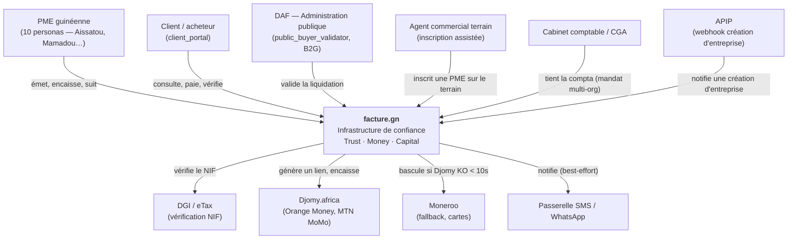
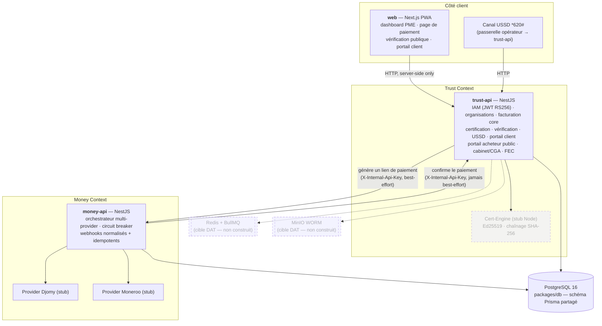
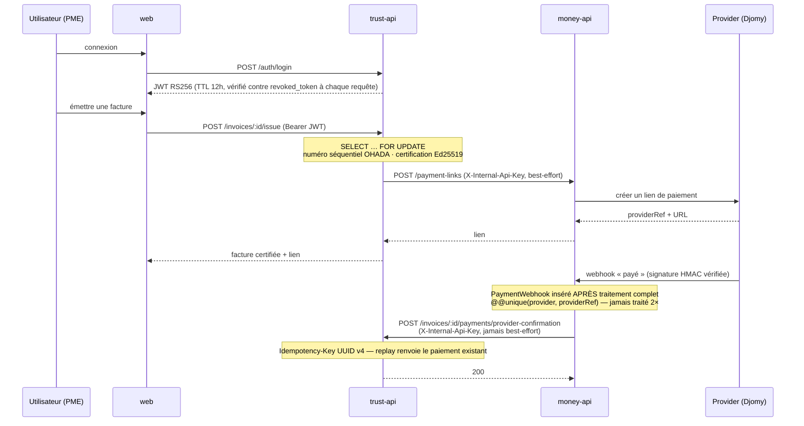

# Architecture — facture.gn

Diagrammes C4 (niveaux 1 et 2) et flux d'authentification. Rendu Mermaid natif sur
GitHub. Source de vérité métier : `../../../V/DAT-facture-gn.md`.

État au 2026-08-29 : `trust-api`, `money-api`, `web`, `packages/db` sont scaffoldés.
Cert-Engine Rust, Redis/BullMQ, MinIO, Capital/Platform Contexts : cibles DAT non
encore construites (en pointillés ci-dessous).

## Niveau 1 — Contexte

**Positionnement non négociable** : tiers de confiance privé certifié, jamais un
registre ou une autorité d'État. Le marchand reçoit toujours 100 % du montant
facturé ; commission et frais gateway sont portés par le payeur.

## Niveau 2 — Conteneurs

**Note sur les bases** : `trust-api` et `money-api` partagent une instance Postgres
via `packages/db`. Les tables `payment_provider_attempt` / `payment_webhook` sont la
propriété d'écriture exclusive de `money-api` (séparation applicative, pas encore au
niveau base — cible : schémas Postgres distincts).

## Flux d'authentification inter-services

### Secrets inter-services (un par périmètre de confiance, jamais réutilisés)

| Secret | Périmètre |
|---|---|
| `MONEY_API_INTERNAL_KEY` | trust-api ↔ money-api |
| `DGI_VERIFICATION_INTERNAL_KEY` | déclenchement de la vérification DGI (backoffice) |
| `COMMERCIAL_AGENT_GRANT_INTERNAL_KEY` | octroi du statut agent terrain |
| `COMMISSION_BYPASS_REVIEW_INTERNAL_KEY` | outil interne Squad Money |
| `APIP_WEBHOOK_SECRET` | partenaire externe APIP (clé + HMAC-SHA256 sur corps brut) |
| `CERTIFICATION_MASTER_KEY` | enveloppe AES-256-GCM des clés Ed25519 par organisation |

## Voir aussi

- `../plans/` — un plan par story livrée (contexte, décisions, alternatives écartées)
- `../../CONTRIBUTING.md` — workflow, conventions, pièges
- `../../../V/Registre-ADR-facture-gn.md` — décisions d'architecture datées
